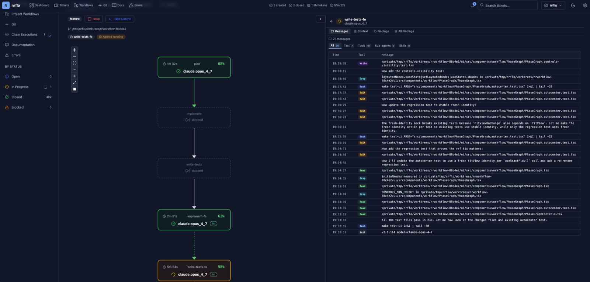

# NRFLO

**Self-hosted orchestrator for Claude Code and Codex agents.** Run multi-agent coding workflows in parallel, in isolated git worktrees, on the CLI subscriptions you already pay for (Claude Pro / Max, ChatGPT) — and take over any live agent from the browser.

<p align="center">
  <a href="https://github.com/nrflo/nrflo/releases/latest"></a>
  <a href="LICENSE"></a>
  <a href="https://github.com/nrflo/nrflo/pkgs/container/nrflo-server"></a>
</p>

<p align="center">
  <a href="https://nrflo.com/#media"></a>
</p>

<p align="center">
  <a href="https://nrflo.com/#media"><strong>▶ Watch the demo</strong></a> ·
  <a href="https://nrflo.com/"><strong>nrflo.com</strong></a> ·
  <a href="doc/"><strong>Docs</strong></a>
  https://github.com/user-attachments/assets/fe6f1b00-38d4-4bb7-ab10-871a83b270d5
</p>

## Quick Start

**macOS (Homebrew):**

```bash
brew tap nrflo/tap && brew install nrflo
nrflo_server
```

**Docker (any OS):**

```bash
docker run -d -p 6587:6587 -v nrflo-data:/data ghcr.io/nrflo/nrflo-server --insecure-cookies
```

**Linux (latest release, amd64/arm64):**

```bash
VERSION=$(curl -fsSLI -o /dev/null -w '%{url_effective}' https://github.com/nrflo/nrflo/releases/latest | sed 's#.*/v##')
ARCH=$(uname -m | sed 's/x86_64/amd64/;s/aarch64/arm64/')
curl -fsSL "https://github.com/nrflo/nrflo/releases/download/v${VERSION}/nrflo_${VERSION}_linux_${ARCH}.tar.gz" \
  | sudo tar -xz -C /usr/local/bin nrflo_server
nrflo_server --insecure-cookies
```

Open http://localhost:6587 and sign in as **`admin` / `admin`** — change the password immediately (**Settings → Administration → Users**). More install options and details: [Installation](#installation).

## Why NRFLO

- **Repeatable engineering workflows** — define an implementation process once, then run it consistently across tickets and projects
- **Human supervision built in** — take over a live run, guide the agent directly, then resume orchestration without losing state
- **Self-hosted by design** — keep prompts, runtime state, execution, and repository access under your own control
- **Mixed-agent compatible** — run workflows across Claude Code and Codex without changing the workflow model
- **Uses your existing CLI subscriptions. No API billing required.** NRFLO drives Claude Code and Codex as PTY-attached interactive sessions you can take over live in the browser, reusing each tool's local login (Claude Pro / Max, ChatGPT). For Anthropic users, an optional in-process **API mode** is available as an admin-toggled runtime setting, with OAuth bearer support to bill against a Claude subscription rather than API keys.

## How It Works

1. Pick a ticket-scoped or project-scoped workflow from the web UI.
2. NRFLO starts agents by layer, running same-layer agents concurrently.
3. Agents write findings that downstream agents can consume in their prompts.
4. If a verifier finds a problem, it can callback an earlier layer and re-run the workflow from that point.
5. If automation gets stuck or needs direction, you can switch to interactive control in the browser.
6. On success, NRFLO merges worktree changes, can invoke a conflict resolver, and reports the final workflow result.

## Core capabilities

<details>
<summary>Full feature list</summary>


**Orchestration**

- Vendor-agnostic orchestration across Claude Code and Codex
- Layered execution with same-layer parallelism and sequential layer progression
- Ticket-scoped and project-scoped workflows
- Dependency-aware sequential ticket chains
- Endless loop mode for project-scoped workflows that re-spawn after completion
- Per-agent low-consumption toggle that swaps to a cheaper model on the fly
- Workflow export/import for sharing definitions between projects or installations
- Import Spec entry point with a `spec-normalizer` agent that turns free-form specs into workflow input
- Declarative per-agent `validation_commands` that run after a pass and gate the layer

**Scheduled execution**

- Cron-driven scheduler dispatches workflows or workflow chains on a schedule
- Per-task fan-out across multiple workflows with run-row tracking
- Ad-hoc "run now" trigger from the UI; full run history retained per task

**Handoffs and validation**

- Structured findings handoffs between agents
- Verifier callbacks that re-run earlier layers with explicit instructions
- Prompt templates, findings expansion, and model controls

**Human control and recovery**

- Browser takeover of live runs (kill-and-resume, or live viewer-attach)
- Interactive start, plan mode, and resume flows
- PTY-backed sessions for Claude and Codex with live keystroke capture
- Idle/nudge loop that prompts unresponsive interactive agents before failing them
- Low-context continuation, stall restart, manual restart, and retry from the failed layer

**Git and delivery**

- Isolated git worktrees for ticket execution
- Automatic merge handling
- Conflict-resolver agent on failed merge
- Optional push after merge

**Artifacts and external access**

- Per-project artifact storage with local, Cloudflare R2, and S3 backends
- Artifact uploader in the Run Workflow form; per-agent and all-artifacts UI tabs
- Service tokens — long-lived project-scoped bearer tokens for external REST callers
- External MCP bridge (`nrflo_server agent mcp-external`) — any MCP client drives the server's tool catalogue with a service token

**Rate limits**

- CLI-side and API-mode rate-limit detection with automatic backoff and relaunch
- UI rate-limit badge with WS-driven countdown

**Notifications**

- Per-project Slack and Telegram channels for workflow events
- Custom Python-script notification channels for routing events to anything else

**Observability**

- Real-time workflow graph
- Logs, findings, and final results
- Dedicated errors page recording agent failures, workflow failures, and merge-conflict events
- Paginated agent session log page (`/logs`) for finished sessions with workflow and schedule context

</details>

## Installation

### Homebrew (macOS)

```bash
brew tap nrflo/tap
brew install nrflo
```

To upgrade, review [Breaking Changes and Migration Guides](BREAKING_CHANGES.md) first, then:

```bash
brew update && brew upgrade nrflo
```

### Docker

```bash
docker run -d -p 6587:6587 -v nrflo-data:/data ghcr.io/nrflo/nrflo-server
```

The image (`linux/amd64`, `linux/arm64`) bundles the Claude Code and Codex CLIs, runs non-root, and keeps all state in the `/data` volume. Append `--insecure-cookies` when serving over plain HTTP. CLI agents authenticate from env (`ANTHROPIC_OAUTH_TOKEN` / `ANTHROPIC_API_KEY` for Claude, `OPENAI_API_KEY` / `CODEX_API_KEY` for Codex); API mode ships off and is enabled from Settings.

### Linux tarball

Releases ship `nrflo_<version>_linux_{amd64,arm64}.tar.gz` (version without the `v` prefix) on the [releases page](https://github.com/nrflo/nrflo/releases); the Quick Start snippet resolves the latest one. There is no system tray on Linux; the server runs headless at http://localhost:6587.

When serving over plain HTTP (e.g. localhost or a LAN), start the server with `--insecure-cookies` so the session cookie is not marked `Secure` and login works in the browser:

```bash
nrflo_server --host 0.0.0.0 --insecure-cookies
```

Drop `--insecure-cookies` once the server is fronted by HTTPS.

### Build from source

```bash
make build && make install
nrflo_server
```

Use `nrflo_server --host 0.0.0.0` to make the server accessible on the local network.

## Tech Stack

| Layer | Technologies |
|-------|-------------|
| **Backend** | Go 1.25, Cobra CLI, SQLite (modernc.org/sqlite), gorilla/websocket, golang-migrate, creack/pty |
| **Frontend** | React 19, TypeScript 5.9, TanStack Query, Zustand, Tailwind CSS v4, xterm.js, React Flow, CodeMirror 6, Zod |
| **Database** | SQLite (`~/.nrflo/nrflo.data`), auto-migrating schema |

## CLI Overview

NRFLO ships a single binary, `nrflo_server`:

| Command | Description |
|---------|-------------|
| `nrflo_server` / `nrflo_server serve` | Start the server: web UI, REST API, WebSocket, agent socket |
| `nrflo_server console` | Native terminal console for server-owned Claude/Codex/API conversations |
| `nrflo_server agent mcp-external` | MCP bridge for external MCP clients (see below) |
| `nrflo_server agent mcp` | MCP bridge for spawned agents (invoked by the spawner) |
| `nrflo_server agent record-event` / `statusline` / `context-update` | Agent infrastructure hooks (invoked by the spawner) |
| `nrflo_server version` | Print version |

There is no separate agent CLI: spawned agents drive nrflo (findings, lifecycle, artifacts, tickets, …) through MCP tools (`mcp__nrflo__*`) served by the `agent mcp` bridge, which the spawner wires up automatically.

See the agent authoring docs under [doc/](doc/) (served at /documentation in the web UI).

### External MCP access (`agent mcp-external`)

Any MCP client — Claude Code, Codex CLI, an IDE, or your own agent — can drive a running nrflo server through the same tool catalogue the local console uses. Mint a service token in **Settings → Administration → Service Tokens**, then register the bridge with your client:

```bash
claude mcp add nrflo --env NRFLO_MCP_TOKEN=<service token> -- nrflo_server agent mcp-external
```

The bridge reads `NRFLO_MCP_TOKEN` (required), `NRFLO_SERVER_URL` (default `http://127.0.0.1:6587`), and `NRFLO_PROJECT` (optional — the working directory is matched against project root paths first). The tool catalogue is server-owned, so new server-side tools appear without any client update. Full reference: [doc/mcp-external.md](doc/mcp-external.md).

### Local console (`nrflo_server console`)

`nrflo_server console [--project <id>] [--server <url>] [--token <service token>]` opens a native terminal picker populated from the server's enabled engines/models and live chats. Choose a new Claude, Codex, or API conversation, or resume one with its existing provider context; scripts can bypass the picker with `--engine ... [--model ...]`, and `--resume <session-id>` attaches directly.

Local use needs no token because the trusted Unix socket returns a bearer scoped to the selected chat. Remote use requires a service token from **Settings → Administration → Service Tokens**; project and server flags fall back to `NRFLO_PROJECT`/cwd detection and `NRFLO_SERVER_URL`. Ctrl+D detaches so the server-owned conversation can be resumed, while Ctrl+X explicitly closes it; Ctrl+F searches, Ctrl+G enters copy/navigation mode, and reconnects reconcile persisted history plus in-flight output and approvals.

## Workflows

Workflows are stored in the database and edited through the web UI. A workflow is a sequence of agent layers with validation boundaries. Example configurations:

| Workflow | Phases (by layer) | Use Case |
|----------|-------------------|----------|
| `feature` | L0: setup-analyzer &rarr; L1: test-writer &rarr; L2: implementor &rarr; L3: qa-verifier &rarr; L4: doc-updater | New features (full TDD) |
| `bugfix` | L0: setup-analyzer &rarr; L1: implementor &rarr; L2: qa-verifier | Bug fixes |
| `hotfix` | L0: implementor | Urgent fixes |
| `docs` | L0: setup-analyzer &rarr; L1: doc-updater | Documentation only |
| `refactor` | L0: setup-analyzer &rarr; L1: implementor &rarr; L2: qa-verifier | Code refactoring |

All agents in the same layer run concurrently. The next layer starts only after the current layer completes (at least one agent must pass). Parallel-to-parallel topologies are supported — no restriction on the agent count of the next layer.

## Architecture

At runtime, the server owns orchestration, process spawning, websocket updates, and persistent workflow state.

The server runs everything in-process: the orchestrator groups phases by layer, the spawner launches agent processes, and the WebSocket hub broadcasts real-time updates to connected clients. Agent definitions (prompts, models, timeouts) and workflow definitions are stored in the database and managed through the web UI.

## Build & Test

| Target | Description |
|--------|-------------|
| `make build` | Build the server binary (dev, includes UI) |
| `make build-release` | Optimized release build |
| `make install` | Install to `/usr/local/bin` (override with `PREFIX=...`) |
| `make test` | Run backend tests |
| `make test-ui` | Run frontend tests |
| `make test-pkg PKG=...` | Run tests for a single backend package |
| `make clean` | Remove build artifacts |
| `make tidy` | Tidy Go module dependencies |
| `make help` | Show all available targets |

## Authentication

The web UI is protected by username/password sessions. On first launch the database is seeded with a single admin account:

| Field | Value |
|-------|-------|
| Username | `admin` |
| Password | `admin` |

Change it from **Settings → Administration → Users** as soon as you log in. The Users page (admin only) supports creating, updating, and deactivating users; an Audit Log page records administrative actions. Failed login attempts are rate-limited per IP and email.

When running the server over plain HTTP for local development, start it with `--insecure-cookies` so the session cookie is not marked `Secure`.

## Configuration

| Variable | Default | Description |
|----------|---------|-------------|
| `NRFLO_HOME` | `~/.nrflo` | Data directory (database, logs) |
| `NRFLO_PROJECT` | — | Project identifier (discovered from env) |

Logs are written to `$NRFLO_HOME/logs/be.log`.

## License

Released under the [Apache License 2.0](LICENSE).
