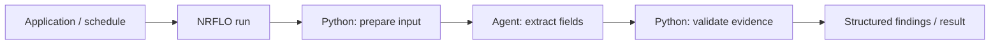

# NRFLO

**Structured workflows for AI-powered applications.**

NRFLO is a self-hosted workflow engine that combines AI agents, deterministic
Python scripts, and parallel execution with structured outputs, validation,
and human control. Your application starts and inspects runs through REST or
MCP; NRFLO coordinates the execution stages.

Use one agent when one agent is enough. Use NRFLO when the process needs more
structure than a single session.

[Get started](#quick-start) · [Documentation](doc/README.md) ·
[Mixed workflow example](doc/mixed-workflow.md) · [Application API](doc/application-integration.md) ·
[Coding workflows](doc/coding-workflows.md)

<p align="center">
  <a href="https://github.com/nrflo/nrflo/releases/latest"></a>
  <a href="LICENSE"></a>
  <a href="https://github.com/nrflo/nrflo/pkgs/container/nrflo-server"></a>
</p>

<p align="center">
  <a href="https://nrflo.com/"><strong>nrflo.com</strong></a> ·
  <a href="doc/"><strong>Docs</strong></a>
</p>

## Quick Start

**macOS (Homebrew):**

```bash
brew tap nrflo/tap && brew install nrflo
nrflo_server
```

**Docker (any OS):**

```bash
docker run -d -p 6587:6587 -v nrflo-data:/data ghcr.io/nrflo/nrflo-server --insecure-cookies
```

**Linux (latest release, amd64/arm64):**

```bash
VERSION=$(curl -fsSLI -o /dev/null -w '%{url_effective}' https://github.com/nrflo/nrflo/releases/latest | sed 's#.*/v##')
ARCH=$(uname -m | sed 's/x86_64/amd64/;s/aarch64/arm64/')
curl -fsSL "https://github.com/nrflo/nrflo/releases/download/v${VERSION}/nrflo_${VERSION}_linux_${ARCH}.tar.gz" \
  | sudo tar -xz -C /usr/local/bin nrflo_server
nrflo_server --insecure-cookies
```

Open http://localhost:6587 and sign in as **`admin` / `admin`** — change the password immediately (**Settings → Administration → Users**). More install options and details: [Installation](#installation).

## When a prompt becomes a process

- **Define the stages.** Ordered layers, same-layer parallel work, configurable
  fan-in, and tag-based conditional skips.
- **Run code where code is enough.** Python scripts handle transforms, API calls,
  and checks; agents handle interpretation and reasoning.
- **Pass explicit results.** Findings and artifacts carry data between steps;
  configured validation commands and verifier callbacks govern corrections.
- **Call it from your application.** REST and external MCP access use
  project-scoped service tokens.
- **Inspect and intervene.** Live graphs, timelines, logs, notifications,
  pause boundaries, and supported CLI takeover keep operators involved.
- **Self-host.** One Go server binary, embedded React UI, SQLite persistence,
  Docker or native installation, Apache-2.0 license.

## Example: document intake



The [runnable example](doc/mixed-workflow.md) includes a local fixture, an
importable workflow bundle generator, and deterministic evidence checks.
The model interprets text; the script verifies types and source quotations.
It is a starter workflow, not a built-in document-processing product.

Independent work can share a layer with `all` fan-in when every result is
required. Conditional skips, callback rework, and human pause points are
[configured separately](doc/common-40-workflow.md).

## Applications use NRFLO as an execution backend

Your application owns domain state and external side effects. NRFLO runs the
workflow and records its state, findings, logs, and artifacts.

1. Create a project-scoped service token in the UI.
2. Start a defined project workflow with
   `POST /api/v1/projects/{id}/workflow/run`.
3. Store the returned `instance_id`; retrieve that run through
   `GET /api/v1/projects/{id}/workflow?instance_id=...`.
4. Read the matching entry in `all_workflows` for status and findings.

[Integration guide and exact requests](doc/application-integration.md) ·
[External MCP](doc/mcp-external.md)

[TransferDue](https://transferdue.com), a separate product built by the NRFLO
maintainer, uses the HTTP API for condominium document analysis. It uploads
artifacts, starts ticket-scoped workflows, and receives results through
application-specific Python notification scripts. This is a first-party
integration, not an independent customer endorsement.
[Read the verified architecture](doc/transferdue.md).

## Choose the execution mode for each step

| Mode | Executes | Requirements |
|------|----------|--------------|
| `script` | Stored Python code using the findings SDK | Python 3; no model needed |
| `api` | NRFLO's in-process tool-use loop | Admin enables API mode; configured provider credentials and model |
| `cli_interactive` | Claude Code or Codex integration | Installed, authenticated provider CLI |

API mode supports Anthropic, OpenAI, OpenRouter, and configured local
OpenAI-compatible providers. CLI accounts and API credentials follow the
provider's billing and terms. See [API mode](doc/api.md),
[local providers](doc/local-providers.md), and [Python](doc/python.md).

## Coding workflows

Claude Code and Codex workflows remain fully supported: implementation,
tests, QA, documentation, ticket worktrees, merge/conflict resolution, and
browser takeover for supported live CLI sessions.

[Coding setup and workflow walkthrough](doc/coding-workflows.md)

<details>
<summary>Watch a coding workflow</summary>

https://github.com/user-attachments/assets/fe6f1b00-38d4-4bb7-ab10-871a83b270d5

</details>

## Operations and fit

NRFLO is useful when execution needs reusable stages, mixed code and reasoning,
validation, or external control. For a single model call, an ordinary SDK call
may be simpler.

Runs execute on one self-hosted server. State persists in SQLite; on startup,
orphaned in-flight work is marked failed. Retries and callbacks may repeat
external actions, so the caller must reconcile side effects and implement
idempotency. Scripts and CLI tools run in a trusted host environment.
[Execution and security boundaries](doc/execution-semantics.md).

[Provider capability matrix](capabilities.md) records the last manual-suite
results, including skipped scenarios; it is not a guarantee for every runtime.

## Installation

### Homebrew (macOS)

```bash
brew tap nrflo/tap
brew install nrflo
```

To upgrade, review [Breaking Changes and Migration Guides](BREAKING_CHANGES.md) first, then:

```bash
brew update && brew upgrade nrflo
```

### Docker

```bash
docker run -d -p 6587:6587 -v nrflo-data:/data ghcr.io/nrflo/nrflo-server
```

The image (`linux/amd64`, `linux/arm64`) bundles the Claude Code and Codex CLIs, runs non-root, and keeps all state in the `/data` volume. Append `--insecure-cookies` when serving over plain HTTP. CLI agents authenticate from env (`ANTHROPIC_OAUTH_TOKEN` / `ANTHROPIC_API_KEY` for Claude, `OPENAI_API_KEY` / `CODEX_API_KEY` for Codex); API mode ships off and is enabled from Settings.

### Linux tarball

Releases ship `nrflo_<version>_linux_{amd64,arm64}.tar.gz` (version without the `v` prefix) on the [releases page](https://github.com/nrflo/nrflo/releases); the Quick Start snippet resolves the latest one. There is no system tray on Linux; the server runs headless at http://localhost:6587.

When serving over plain HTTP (e.g. localhost or a LAN), start the server with `--insecure-cookies` so the session cookie is not marked `Secure` and login works in the browser:

```bash
nrflo_server --host 0.0.0.0 --insecure-cookies
```

Drop `--insecure-cookies` once the server is fronted by HTTPS.

### Build from source

```bash
make build && make install
nrflo_server
```

Use `nrflo_server --host 0.0.0.0` to make the server accessible on the local network.

## Tech Stack

| Layer | Technologies |
|-------|-------------|
| **Backend** | Go 1.25, Cobra CLI, SQLite (modernc.org/sqlite), gorilla/websocket, golang-migrate, creack/pty |
| **Frontend** | React 19, TypeScript 5.9, TanStack Query, Zustand, Tailwind CSS v4, xterm.js, React Flow, CodeMirror 6, Zod |
| **Database** | SQLite (`~/.nrflo/nrflo.data`), auto-migrating schema |

## CLI Overview

NRFLO ships a single binary, `nrflo_server`:

| Command | Description |
|---------|-------------|
| `nrflo_server` / `nrflo_server serve` | Start the server: web UI, REST API, WebSocket, agent socket |
| `nrflo_server console` | Native terminal console for server-owned Claude/Codex/API conversations |
| `nrflo_server agent mcp-external` | MCP bridge for external MCP clients (see below) |
| `nrflo_server agent mcp` | MCP bridge for spawned agents (invoked by the spawner) |
| `nrflo_server agent record-event` / `statusline` / `context-update` | Agent infrastructure hooks (invoked by the spawner) |
| `nrflo_server version` | Print version |

There is no separate agent CLI: spawned agents drive nrflo (findings, lifecycle, artifacts, tickets, …) through MCP tools (`mcp__nrflo__*`) served by the `agent mcp` bridge, which the spawner wires up automatically.

See the agent authoring docs under [doc/](doc/) (served at /documentation in the web UI).

### External MCP access (`agent mcp-external`)

Any MCP client — Claude Code, Codex CLI, an IDE, or your own agent — can drive a running nrflo server through the same tool catalogue the local console uses. Mint a service token in **Settings → Administration → Service Tokens**, then register the bridge with your client:

```bash
claude mcp add nrflo --env NRFLO_MCP_TOKEN=<service token> -- nrflo_server agent mcp-external
```

The bridge reads `NRFLO_MCP_TOKEN` (required), `NRFLO_SERVER_URL` (default `http://127.0.0.1:6587`), and `NRFLO_PROJECT` (optional — the working directory is matched against project root paths first). The tool catalogue is server-owned, so new server-side tools appear without any client update. Full reference: [doc/mcp-external.md](doc/mcp-external.md).

### Local console (`nrflo_server console`)

`nrflo_server console [--project <id>] [--server <url>] [--token <service token>]` opens a native terminal picker populated from the server's enabled engines/models and live chats. Choose a new Claude, Codex, or API conversation, or resume one with its existing provider context; scripts can bypass the picker with `--engine ... [--model ...]`, and `--resume <session-id>` attaches directly.

Local use needs no token because the trusted Unix socket returns a bearer scoped to the selected chat. Remote use requires a service token from **Settings → Administration → Service Tokens**; project and server flags fall back to `NRFLO_PROJECT`/cwd detection and `NRFLO_SERVER_URL`. Ctrl+D detaches so the server-owned conversation can be resumed, while Ctrl+X explicitly closes it; use the terminal’s native scrollback, selection, and search; reconnects reconcile persisted history plus in-flight output and approvals.

## Workflows

Workflows are stored in the database and edited through the web UI. A workflow is a sequence of script or agent layers with validation boundaries. Coding templates include: Example configurations:

| Workflow | Phases (by layer) | Use Case |
|----------|-------------------|----------|
| `feature` | L0: setup-analyzer &rarr; L1: test-writer &rarr; L2: implementor &rarr; L3: qa-verifier &rarr; L4: doc-updater | New features (full TDD) |
| `bugfix` | L0: setup-analyzer &rarr; L1: implementor &rarr; L2: qa-verifier | Bug fixes |
| `hotfix` | L0: implementor | Urgent fixes |
| `docs` | L0: setup-analyzer &rarr; L1: doc-updater | Documentation only |
| `refactor` | L0: setup-analyzer &rarr; L1: implementor &rarr; L2: qa-verifier | Code refactoring |

All agents in the same layer run concurrently. The next layer starts after the current layer meets its configured fan-in policy (`any` by default; skipped agents are excluded). Parallel-to-parallel topologies are supported — no restriction on the agent count of the next layer.

## Architecture

At runtime, the server owns orchestration, process spawning, websocket updates, and persistent workflow state.

The server runs everything in-process: the orchestrator groups phases by layer, the spawner launches agent processes, and the WebSocket hub broadcasts real-time updates to connected clients. Agent definitions (prompts, models, timeouts) and workflow definitions are stored in the database and managed through the web UI.

## Build & Test

| Target | Description |
|--------|-------------|
| `make build` | Build the server binary (dev, includes UI) |
| `make build-release` | Optimized release build |
| `make install` | Install to `/usr/local/bin` (override with `PREFIX=...`) |
| `make test` | Run backend tests |
| `make test-ui` | Run frontend tests |
| `make test-pkg PKG=...` | Run tests for a single backend package |
| `make clean` | Remove build artifacts |
| `make tidy` | Tidy Go module dependencies |
| `make help` | Show all available targets |

## Authentication

The web UI is protected by username/password sessions. On first launch the database is seeded with a single admin account:

| Field | Value |
|-------|-------|
| Username | `admin` |
| Password | `admin` |

Change it from **Settings → Administration → Users** as soon as you log in. The Users page (admin only) supports creating, updating, and deactivating users; an Audit Log page records administrative actions. Failed login attempts are rate-limited per IP and email.

When running the server over plain HTTP for local development, start it with `--insecure-cookies` so the session cookie is not marked `Secure`.

## Configuration

| Variable | Default | Description |
|----------|---------|-------------|
| `NRFLO_HOME` | `~/.nrflo` | Data directory (database, logs) |
| `NRFLO_PROJECT` | — | Project identifier (discovered from env) |

Logs are written to `$NRFLO_HOME/logs/be.log`.

## License

Released under the [Apache License 2.0](LICENSE).
