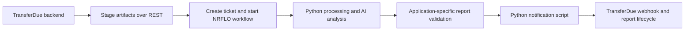

# TransferDue: a separate application using NRFLO

[TransferDue](https://transferdue.com) is a Thailand condominium
transaction-readiness and document-analysis product built by the NRFLO
maintainer. This is a first-party integration, not an independent customer
endorsement. The description below was checked against its application source.

## The service boundary

TransferDue owns accounts, uploads, billing, report state, and presentation.
Its `NrfloEngine` adapter stages documents through NRFLO's artifact API,
creates a ticket with an application report reference, and starts the configured
ticket workflow through `POST /api/v1/tickets/{id}/workflow/run`.
It passes `input_artifacts`, `external_id`, and a JSON-encoded
`external_context` string; the response's `instance_id` links the execution
back to the application's report.

The workflow combines Python preparation/rule/gate steps with model analysis.
A classification gate can reuse existing classifications and skip a tagged
classification agent. Later scripts validate report readiness and assemble the
result. The application's notification script posts the completion payload to
a TransferDue webhook; a failure hook reports unsuccessful execution.

Those webhook contracts and scripts belong to TransferDue. They are not a
universal built-in connector or a generic NRFLO completion-delivery guarantee.
TransferDue authenticates and reconciles those callbacks within its own report
lifecycle. Its source includes tests for artifact upload, run requests,
correlation, callback handling, and validation failures.

## What to reuse

Keep domain rules and state in your application, use a project-scoped token,
and pass explicit inputs and correlation metadata across the service boundary.
Let scripts handle known transformations and checks while agents handle
interpretation. Inspect execution in NRFLO; validate and apply domain results
in the application.

Start with the smaller [document-intake example](mixed-workflow.md) and
[application integration guide](application-integration.md). No customer counts,
latency, uptime, or cost savings are asserted by this case study.
